<div align="center">


# ZeaLead

**Find the people who need your product, with the quote that proves it.**

An open-source autonomous agent that reads public posts and comments on Reddit, Hacker News, X,
LinkedIn, Bluesky, Stack Exchange, GitHub, review sites and forums. It keeps only the people who
show a real need, each with the verbatim quote that proves it.

[](LICENSE)


[Quick start](#quick-start-docker) · [Screenshots](#screenshots) · [How it works](#how-it-works) · [Platforms](#platforms) · [Configuration](#configuration) · [Credits](#credits) · [Security](SECURITY.md)

</div>

---

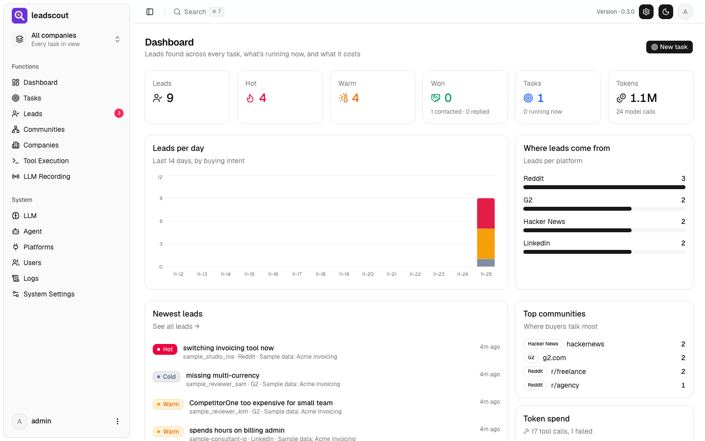

ZeaLead uses the same architecture as [ARTEX](https://github.com/BaaRai/ARTEX), the autonomous
pentest platform. ARTEX explores a target for vulnerabilities; ZeaLead explores public
conversations for buyers. A planner agent decides where to look next. Worker agents search the
platforms, and every lead must survive an adversarial check and match a captured post word for
word before it is recorded.

## Quick start (Docker)

```bash
git clone https://github.com/Zealtouch/ZeaLead && cd ZeaLead
./start.sh                 # creates .env, builds the image, starts the console
```

Open <http://localhost:8790>. The first visit asks you to create the admin account. Then either
add your `ANTHROPIC_API_KEY` to `.env` and run `docker compose up -d`, or add a model profile
under **System → LLM** (Anthropic, OpenAI, any OpenAI-compatible gateway, Ollama or a Bedrock
gateway). Add any platform keys you have to `.env`, then click **New task**.

| Command | What it does |
|---|---|
| `./start.sh` | Build (first run or after `git pull`) and start in the background |
| `docker compose logs -f zealead` | Follow the server log |
| `docker compose down` | Stop. Data stays in the `zealead-data` volume |
| `./reset-password.sh <username>` | Set a new password for a console user |
| `docker compose exec zealead zealead demo` | Add a fictional sample task to explore without API keys |

The console is published on `127.0.0.1` only. To reach it from other machines, put a TLS reverse
proxy in front (or set `ZEALEAD_PUBLISH_ADDR` in `.env` if you accept the risk).

## Without Docker

```bash
python3 -m venv .venv && .venv/bin/pip install -e .
(cd web && npm ci && npm run build:static) && cp -R web/out zealead/webui
cp .env.example .env               # add ANTHROPIC_API_KEY plus any platform keys you have
.venv/bin/zealead serve          # http://localhost:8790
```

Skip the `web` step and `zealead serve` still runs the API; the CLI works on its own:

```bash
cp brief.example.yaml brief.yaml   # describe your product and ideal customer
zealead platforms brief.yaml     # which platforms your keys unlock
zealead run brief.yaml
zealead leads 1 --min warm --messages   # best leads with their drafted messages
zealead draft 1                  # draft messages for leads that have none (--lead N to rewrite one)
```

## Screenshots

| Tasks | Leads |
| :---: | :---: |
| 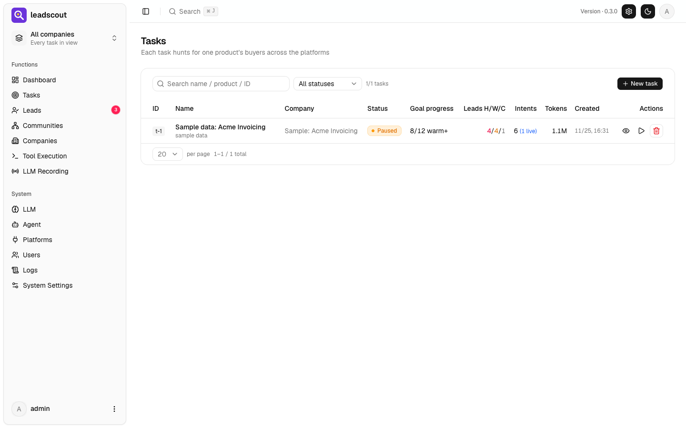 | 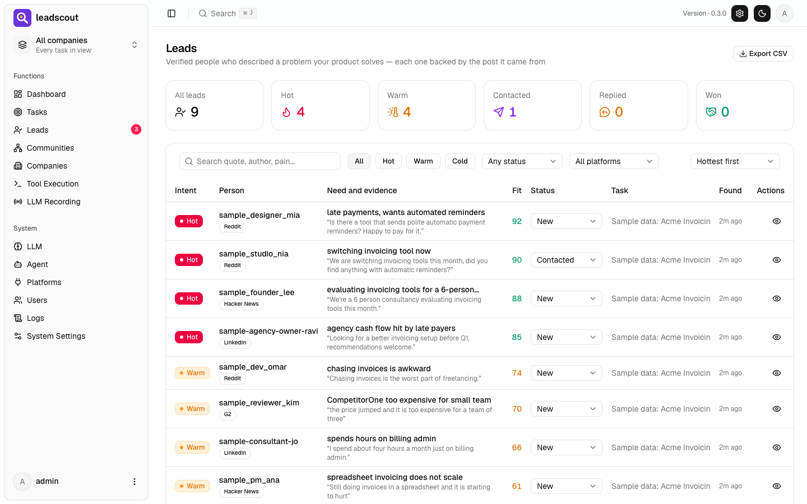 |

| Task execution: sessions and transcripts | Exploration graph |
| :---: | :---: |
| 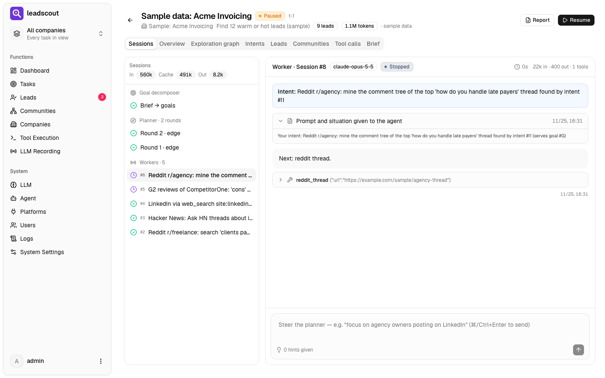 | 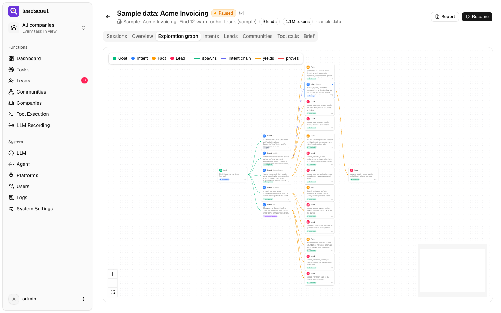 |

| Lead detail: verbatim quote and draft reply | Intent detail: why a node exists |
| :---: | :---: |
| 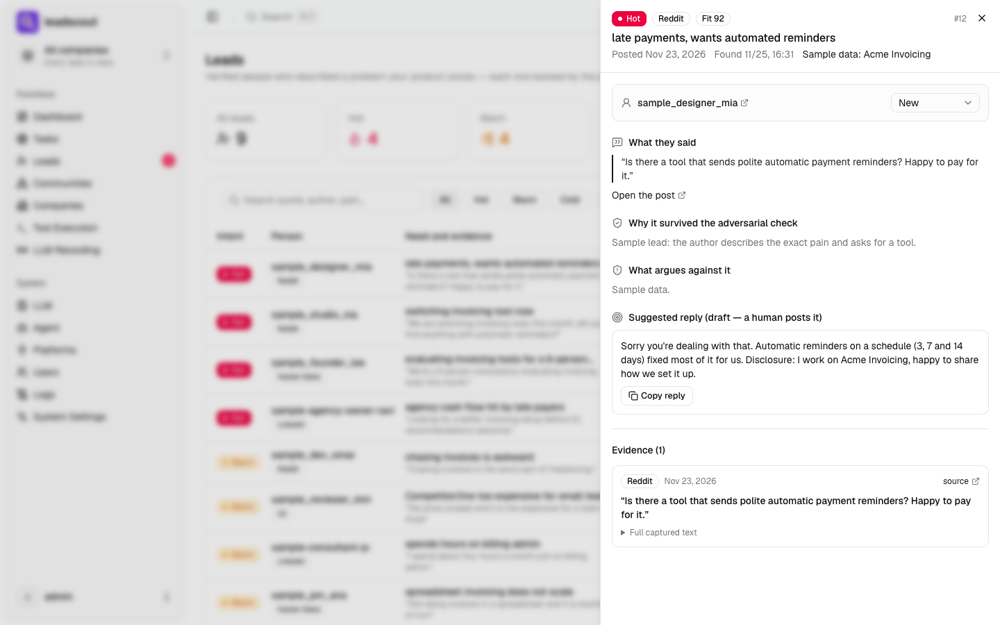 | 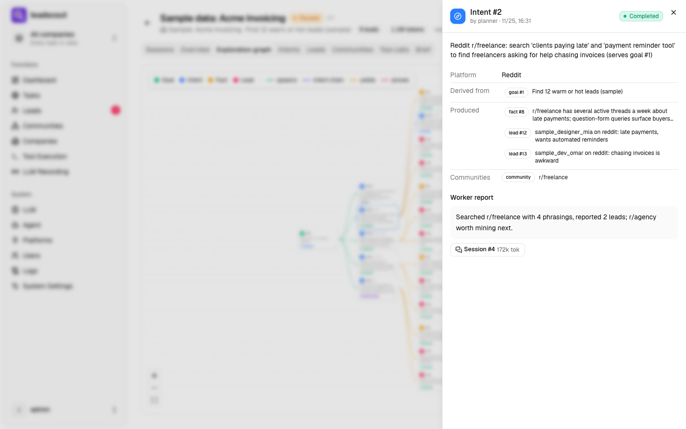 |

| Task overview: goals, todo list, platform yield | Dark mode |
| :---: | :---: |
| 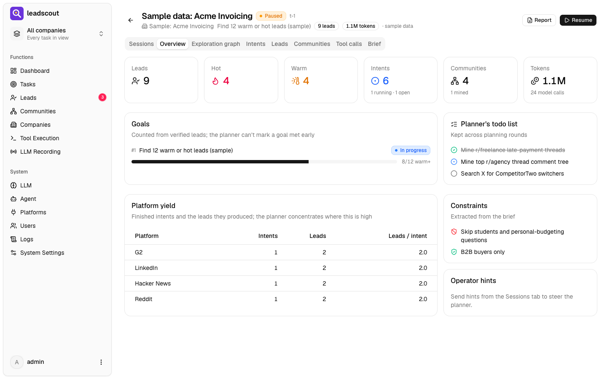 | 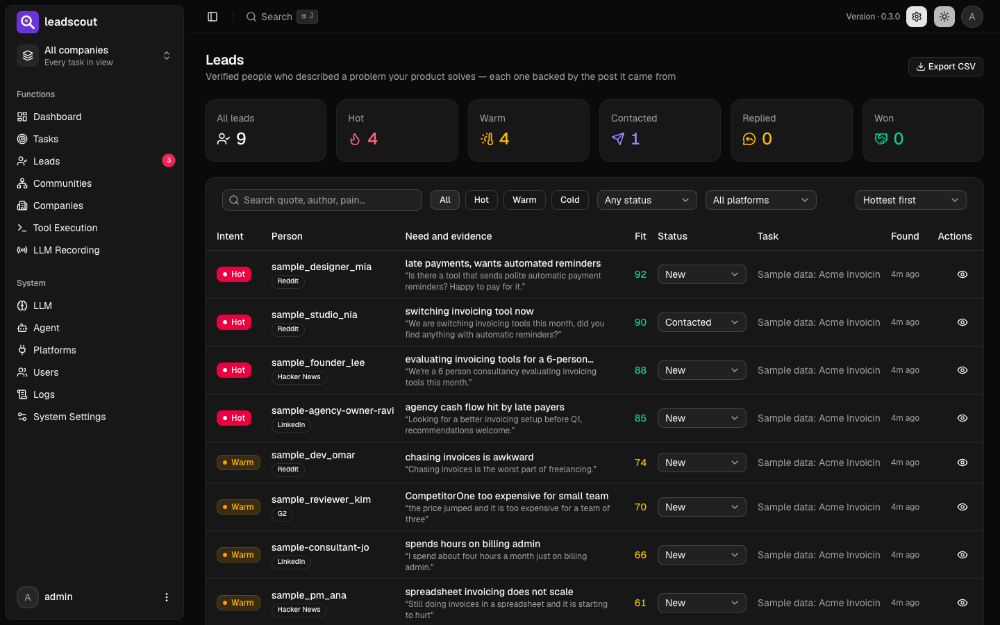 |

<details>
<summary>More screenshots (LLM, tools, agents, platforms, sign-in)</summary>

| LLM recording | Tool execution |
| :---: | :---: |
| 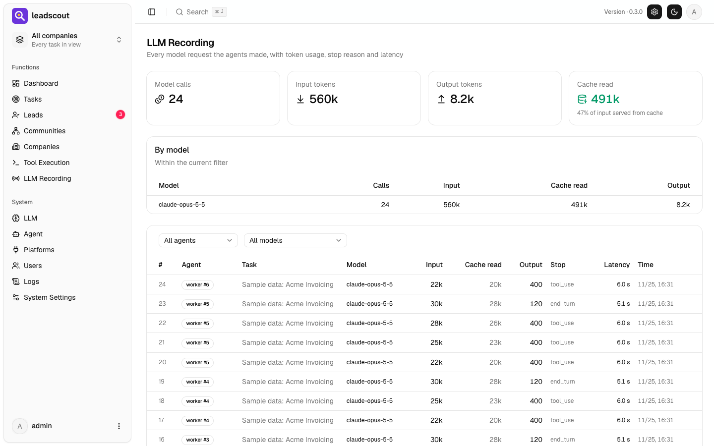 | 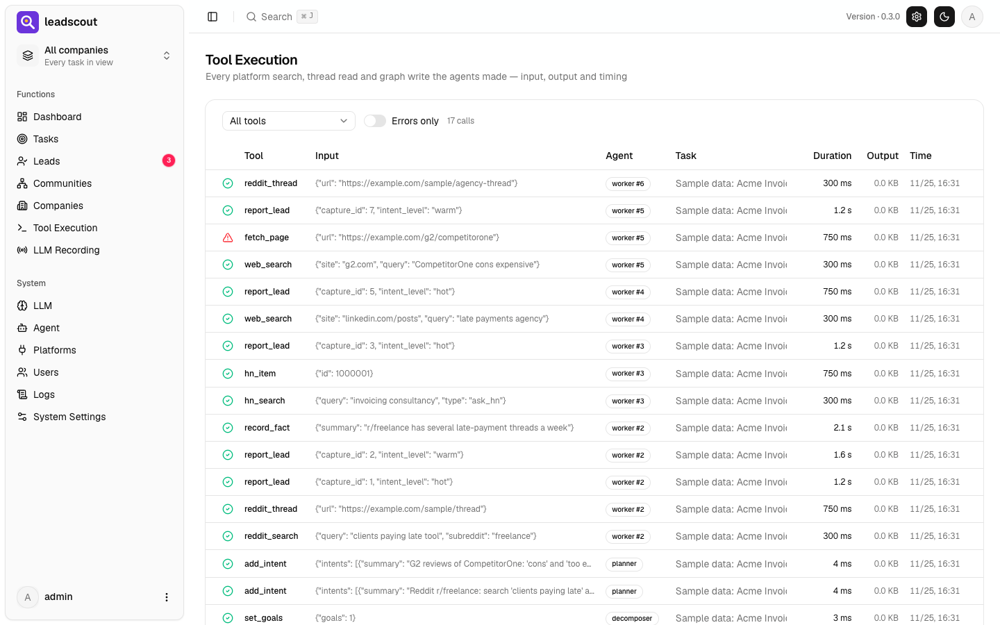 |

| Agent configuration | Platforms |
| :---: | :---: |
| 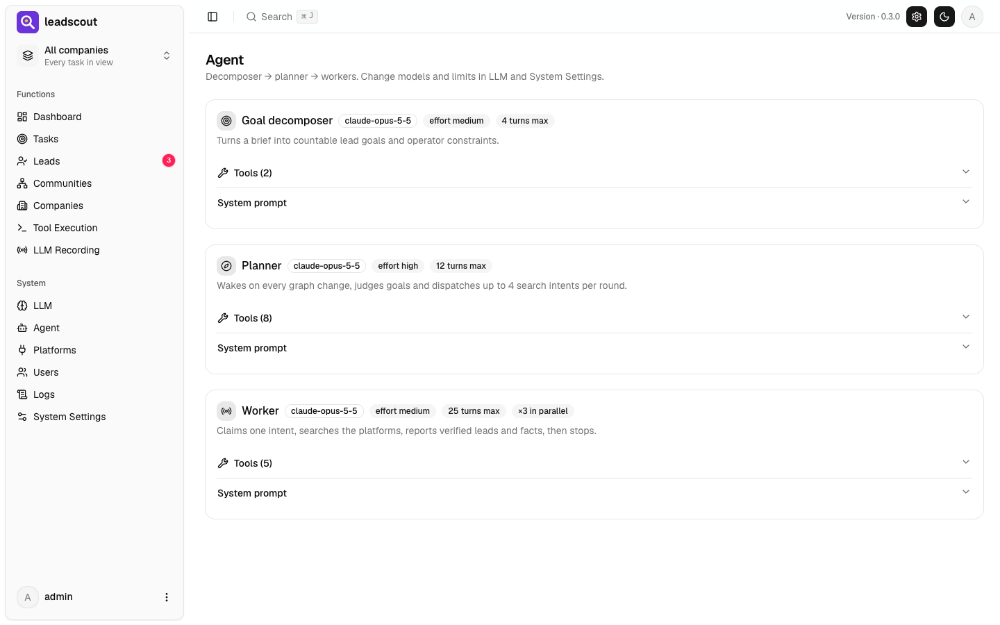 | 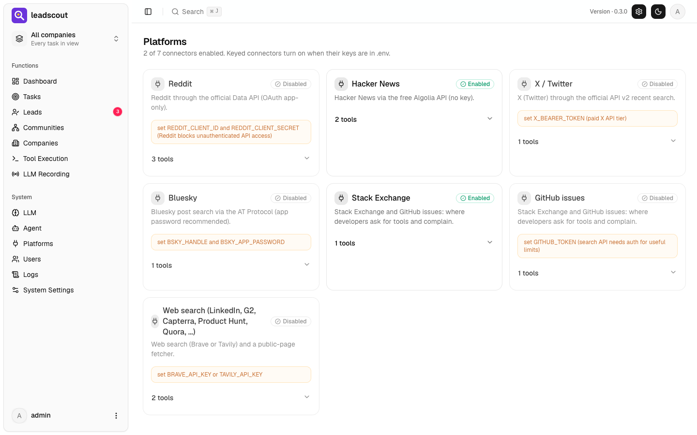 |

| Sign-in | |
| :---: | :---: |
| 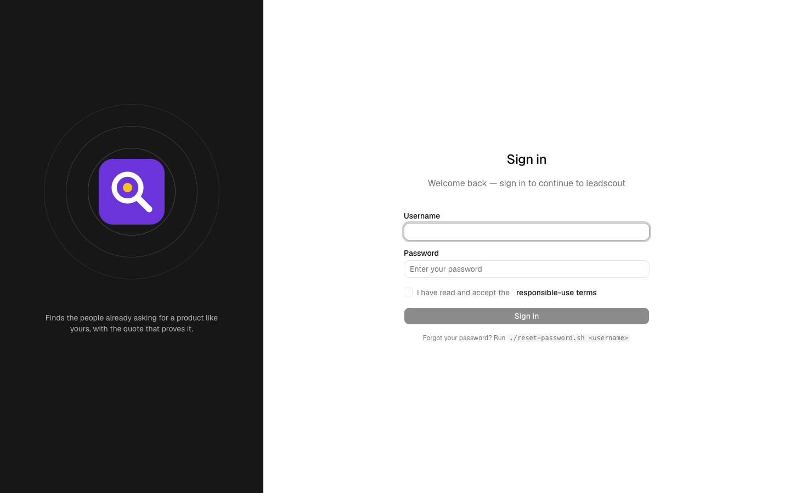 | |

</details>

## The console

The console uses the same layout and theme system as the ARTEX web console: a sidebar with a
company switcher, **Functions** for the work and **System** for configuration.

- **Tasks**: every lead-finding task with live status, leads and spend; create one from a form or
  a YAML brief. Inside a task: **Sessions** (every agent session with its full transcript, updated
  live; steer the planner with a hint), **Overview** (goals, the planner's todo list, platform
  yield, constraints) and the **Exploration graph** (goals → intents → facts and leads; click a
  node to see why it exists).
- **Leads**: filter by intent, status and platform; track outreach; export CSV. Each lead shows
  the verbatim quote, why it survived the adversarial check, a draft reply and the captured
  evidence.
- **LLM Recording** and **Tool Execution**: every model call (tokens, cache hits, stop reason,
  latency) and every search and thread read (input, output, timing).
- **Platforms**: which connectors your keys enable, and their tools.
- **Dashboard**: leads per day, where leads come from, top communities, token spend.
- **Communities**: the subreddits, forums and searches where buyers were found, across tasks.
- **Companies**: group tasks and leads by product or client; the switcher narrows every page.
- **LLM**: model profiles for any provider, the failover pool, per-role pins and the retry
  policy (see [Models](#models)). **Agent**: each role's prompt, tools and the profile it resolves
  to. **System Settings**: run limits and request pacing.
- **Users** (admins): add members or admins, change roles, reset passwords. **Logs**: the activity
  stream of every task.

Sign-in uses accounts stored in the database: passwords are scrypt-hashed, sessions are signed
tokens that expire after 7 days and end when the password changes, and repeated failed sign-ins
are rate limited.

## How it works

```
 brief ──▶ goal decomposer ──▶ goals ("40 warm+ leads, 10 hot") + constraints
                                   │
          ┌────────────────────────▼────────────────────────┐
          │ planner: wakes on every graph change, debounced; │
          │ reads the situation, dispatches 0–4 intents,     │
          │ or calls prove_goal when the count is met        │
          └────────────────────────┬────────────────────────┘
        ┌──────────────┬───────────┴──────────┬──────────────┐
        ▼              ▼                      ▼              ▼
     worker 1       worker 2               worker N   each claims ONE intent,
   reddit_search  web_search site:        hn_search   calls real platform APIs,
   reddit_thread  linkedin.com/posts      x_search    writes back facts + leads
        └──────────────┴───────────┬──────────┴──────────────┘
                                   ▼
  source graph (platform → community → thread)  ◀─anchors─▶  exploration graph
                                   └── every change wakes the planner ──┘
```

For details, see [docs/architecture.md](docs/architecture.md).

### What carried over from ARTEX

| ARTEX | ZeaLead |
|---|---|
| Asset graph (domain → subdomain → service → endpoint), shared across tasks | Source graph (platform → community → thread, plus authors), shared across campaigns |
| Exploration graph: goal / intent / fact / finding / hint | Same, with **lead** in place of finding |
| Anchors and a coverage ledger | Anchors link intents, facts and leads to communities; "communities with signal not yet mined" steers the planner |
| Goal decomposer | Extracts countable lead goals and operator constraints from the brief |
| Event-driven planner: debounce, heartbeat, hard floor, dedup, depth over coverage, todo list | Same rules, aimed at buying-intent searches, plus a per-platform yield table |
| Single-intent workers with an adversarial gate before `report_finding` | Adversarial gate before `report_lead`: vendor? wrong customer profile? already solved? stale? bot? |
| Evidence must match captured traffic | Quotes must appear word for word in the captured post; URL and author come from the capture |
| `prove_goal` refuses early stamping | Refuses while measured leads are below target |
| Nonce-tagged untrusted-output boundary | Applied to every post, comment and snippet |
| Noise governor | Per-host pacing with `quiet / balanced / aggressive` profiles |

### Lead quality

A lead is a person, deduplicated by platform and author.

- **hot**: actively looking to buy, switch or get a recommendation now
- **warm**: has the pain, or is unhappy with a competitor, but isn't shopping yet
- **cold**: loosely related; reported only when the fit is unusually strong

Each lead carries the verbatim quote, post URL, author profile, pain, a fit score from 0 to 100,
why it survived the adversarial check, and what argues against it.

### Personal messages

A message writer drafts two messages for every lead, written around what that person posted:
a **public reply** for their thread (helpful first, affiliation disclosed) and a **direct
message** that picks up their specific situation and ends with one low-pressure question or your
offer. Set who signs, the tone and the offer in the brief's `outreach` section. Code refuses a
draft that doesn't name the product, links anywhere but your product URL, or is a near-copy of a
message already written for another lead, so everyone gets a different message. Drafts appear as
leads are found; edit them, rewrite them with an instruction ("shorter, more formal"), or turn
off auto-drafting on the LLM page's Roles tab. ZeaLead never sends anything: you review and post.

## Models

ZeaLead runs on any LLM you configure under **System → LLM**, with the same options as ARTEX:

- **Model profiles** in five formats: Anthropic, OpenAI Chat Completions, OpenAI Responses API,
  Ollama (local, keyless) and Bedrock-compatible gateways (bearer token, InvokeModel). Each has its
  model (with a model list loaded from the API), base URL, proxy (http, https or socks5), API key,
  per-second and per-minute rate limits, context window, output cap and its field name, thinking
  switch, reasoning effort, streaming on or off, a session-id header for sticky routing or prompt
  caching, a custom User-Agent, and static gateway headers. **Test connection** sends a real
  request with those settings and shows the reply.
- **Roles**: the planner, workers and message writer use the active (starred) profile, or each
  can be pinned to its own profile, for example a strong model for planning and a cheap one for
  messages. Effort is set per role; a profile can override it.
- **Pool and failover**: when on, a role whose profile fails (no balance, dead key, rate limit,
  outage) moves to the next profile by priority; equal priorities share the load, and profiles
  whose context window can't hold the request are skipped. A breaker takes a failing profile out
  for 1, then 5, then 30 minutes and shows its state on the card.
- **Retry and backoff** in five layers (connect, empty response, same-profile stream replay, pool
  breaker, intent rerun), each with its own attempts and interval, globally or per profile.

Keys you enter are write-only: they are stored AES-GCM encrypted under `keys/llm.key`, shown only
as a masked hint, and never sent to a different host (changing a profile's base URL requires
re-entering its key). With no profiles, ZeaLead uses `ANTHROPIC_API_KEY` from `.env` and the model
names on the Roles tab. Tool calling is required, so pick models that support it.

## Platforms

| Platform | How | Needs |
|---|---|---|
| Hacker News | Algolia API: stories, comments, full reply trees | nothing |
| Stack Exchange | API: Stack Overflow, Software Recommendations, Super User, … | nothing (optional key raises the quota) |
| Reddit | Official Data API: search, subreddit discovery, comment trees | `REDDIT_CLIENT_ID` and `REDDIT_CLIENT_SECRET` |
| X | API v2 recent search (last 7 days) with author bios | `X_BEARER_TOKEN` (paid tier) |
| Bluesky | AT Protocol search | handle and app password |
| GitHub | Issue search: complaints and feature requests on competitor repos | `GITHUB_TOKEN` |
| LinkedIn, G2, Capterra, Trustpilot, Product Hunt, Quora, Indie Hackers, forums | Web search with `site:` filters; public pages fetched as text | `BRAVE_API_KEY` or `TAVILY_API_KEY` |

A web search key is the most valuable addition, because it opens LinkedIn and the review sites. To
add a platform, see [docs/connectors.md](docs/connectors.md).

## Responsible use

- **Public data only, through official APIs or search engines.** LinkedIn, X, Facebook,
  Instagram and Threads are never fetched directly; the search engine's snippet is the evidence.
  Each platform's API terms still apply to you. Reddit and X restrict commercial use without an
  agreement.
- **It finds people; it never contacts them.** Suggested replies are drafts for a human to
  post. Mass unsolicited messages get accounts banned and break platform rules.
- **The lead list is personal data.** It stores public posts, handles and profile links. Under
  GDPR (EU and UK) and similar laws, keep it for a defined purpose and delete campaigns when
  you're done.

## Configuration

Settings come from `.env` (see [.env.example](.env.example)); models, effort and limits can be
overridden from the console, and model profiles live under System → LLM.
Without profiles, every role defaults to `claude-opus-5-5` through `ANTHROPIC_API_KEY`, with the
planner at `high` effort, workers at `medium` and the message writer at `low`. A typical campaign of 20–40 intents uses 1–3M tokens. `ZEALEAD_BUDGET_TOKENS` caps
it, and the task's Overview and the LLM Recording page show the spend.

## Development

```bash
pip install -e '.[dev]'
python -m pytest -q && ruff check .

# console, with hot reload, against a local API on :8790
zealead serve &
cd web && npm ci && npm run dev    # http://localhost:3000
```

The tests run the full planner → worker → write-back → re-plan loop with a scripted model and a
fake connector. They need no network and spend nothing on the API. They also exercise the
gates (fabricated quotes, stale posts, duplicate people, early `prove_goal`, the intent cap,
frame-escape attempts) and the console API (first-run setup, sign-in, forged and expired
tokens, rate limits, admin-only routes, security headers, CSV injection, settings that refuse
secrets).

Contributions are welcome. See [CONTRIBUTING.md](CONTRIBUTING.md) and the
[Code of Conduct](CODE_OF_CONDUCT.md), and report vulnerabilities privately as described in
[SECURITY.md](SECURITY.md).

## Credits

ZeaLead is built on [ARTEX](https://github.com/BaaRai/ARTEX), the open-source autonomous
penetration-testing platform. Thanks to the ARTEX authors and contributors: ZeaLead adapts its
two-graph planner/worker architecture, the planner, worker and goal-decomposer prompts, the
evidence and adversarial-gate design, and the web console (layout, sidebar, theme presets, UI
components and exploration-graph layout). See [NOTICE](NOTICE) for the full attribution.

The console's UI components derive from [shadcn/ui](https://ui.shadcn.com) (MIT License).

## License

[AGPL-3.0-or-later](LICENSE). ZeaLead adapts its architecture, prompts and web console from
[ARTEX](https://github.com/BaaRai/ARTEX), which is AGPL-3.0; see [NOTICE](NOTICE). If you modify
ZeaLead and run it as a service for others, you must offer them your modified source.
